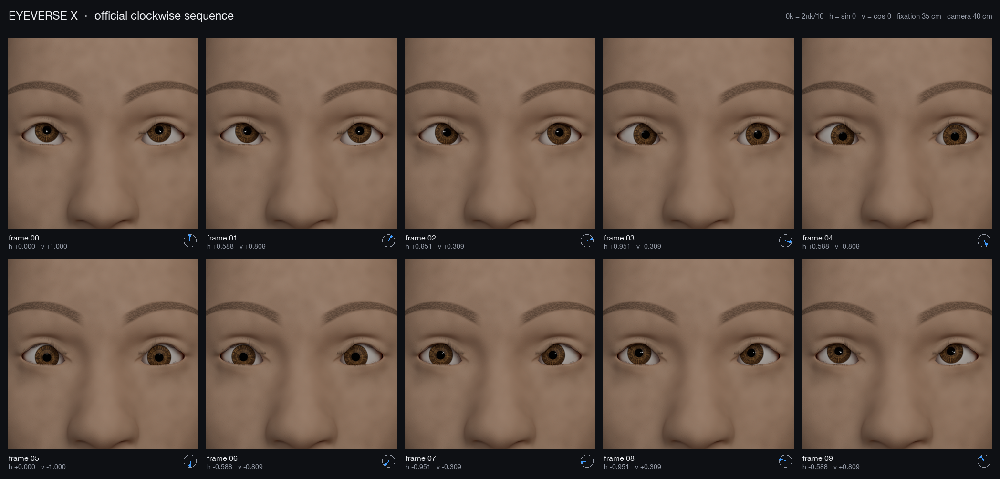
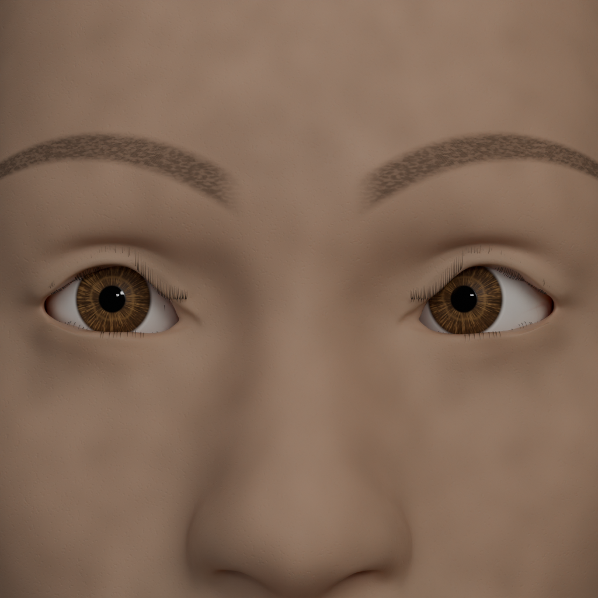
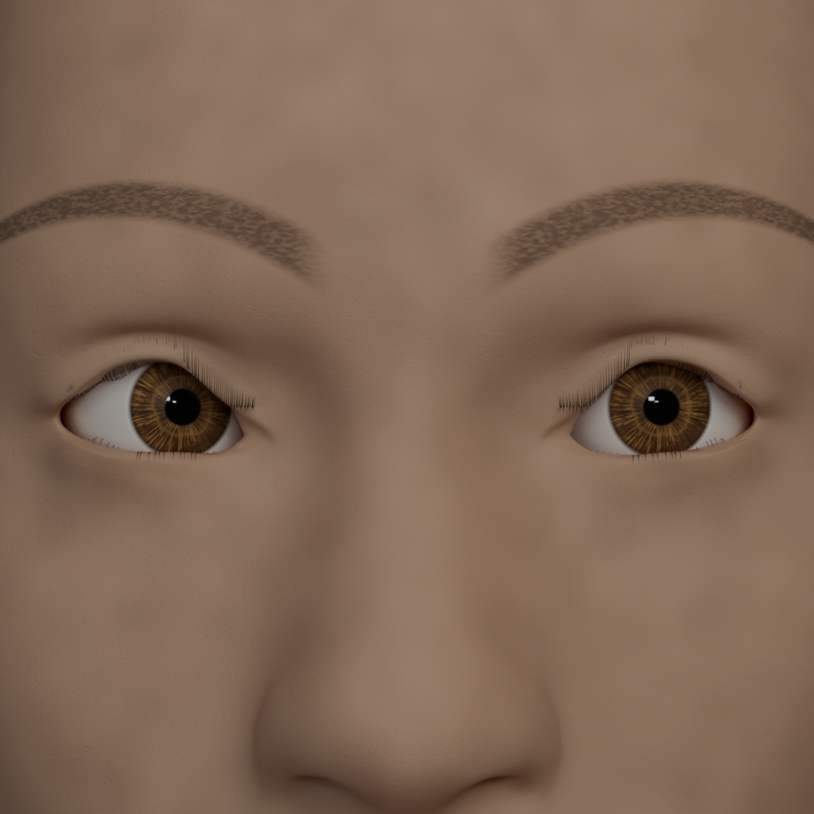
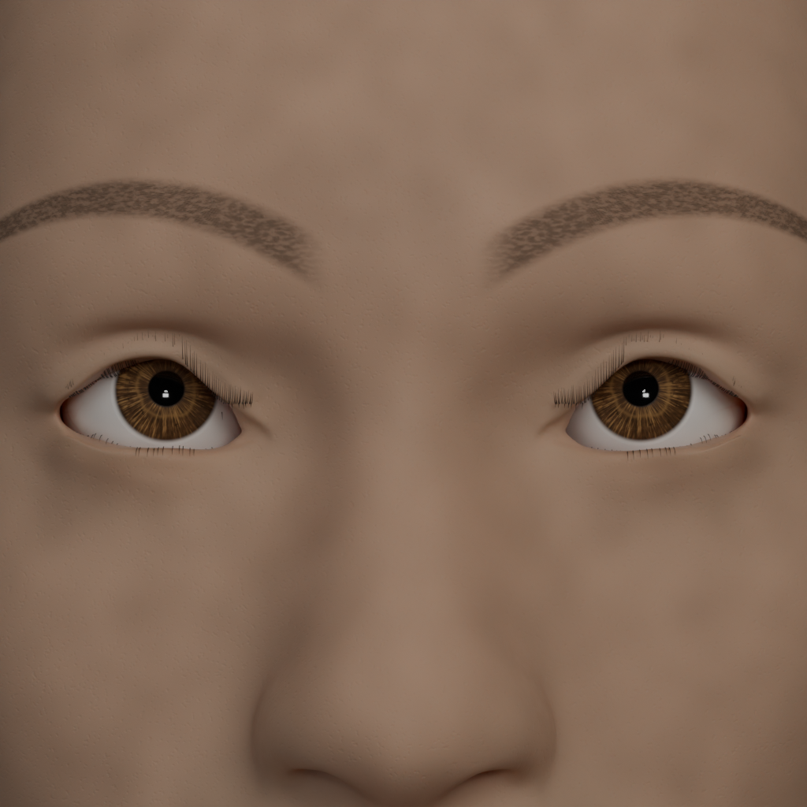
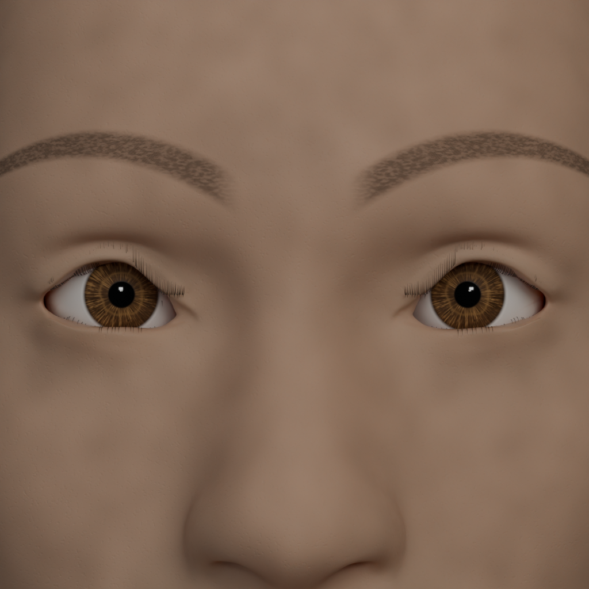

# EYEVERSE X

**Team The Tietans · Thapar Institute of Engineering and Technology · Samsung XR Hackathon 2026, Track 1**

Waris · Kanan · Tanishq · Ananya Dayal

A calibrated eye rig in Blender: a textured MakeHuman face whose eyeballs turn about their own
centres through the `eye.L` / `eye.R` bones, a locked camera 40 cm in front, and a Python wrapper
that moves the eyes, renders them and writes ground truth for every frame. On top of the
mandatory pipeline sits a small synthetic gaze lab for generating and checking training data.



## Presentation and Demo

- [Project presentation (PPTX)](docs/TIET_TheTietans.pptx)
- [Demo video (MP4)](output/eyeverse_demo.mp4)

[](output/eyeverse_demo.mp4)

## Results

<!--RESULTS-->

| check | result |
|---|---|
| Direction check | **5/5** (left -19.0 px, right +19.0 px, up -19.0 px, down +19.0 px, reset returns within 0.0000 px) |
| Clockwise order | pass |
| Metadata schema | valid |
| Analytic model vs Blender scene | 0.0008 px mean, 0.0017 px max |
| Pupil detector vs label (image only) | 0.31 px mean, 0.80 px max |
| 3D gaze reconstructed from pixels | 0.13° mean, 0.34° max |
| Worst eye aim error | 0.180 arc-seconds |

| lab set | frames | flagged by QC | detector median |
|---|---|---|---|
| cameras | 25 | 2 | 0.32 px |
| identities | 30 | 0 | 0.13 px |
| pursuit | 45 | 0 | 0.16 px |
| random | 24 | 1 | 0.47 px |
| rays | 10 | 0 | – |
| saccade | 57 | 0 | 0.14 px |
| vergence | 9 | 0 | 0.14 px |

<p align="center">    </p>
<p align="center"><sub>left · right · up · down · reset</sub></p>

<!--/RESULTS-->

---

## Quick start

Requirements: Blender 4.2 or newer (tested on 5.x), Python 3.10+ with `numpy` and `pillow`.

```bash
pip3 install -r requirements.txt
./run.sh all          # build scene.blend, render the 10 frames, contact sheet, report, dashboard
open dashboard/index.html
```

`run.sh` finds Blender on `PATH` or in `/Applications`. Otherwise:
`export BLENDER=/path/to/blender`.

Cycles renders on the CPU by default, so results are the same on any machine (about a minute
per 1024 × 1024 frame on an M1 MacBook Air). `export EYEVERSE_DEVICE=GPU` switches to Metal,
OptiX, CUDA or HIP.

No terminal? Open `studio.py` in Blender's Text Editor and press **Run Script**. It runs the same
steps in the background and streams the log into the `studio.log` text block. For longer
sessions, `tools/runner.py` turns an open Blender into a job queue fed by `output/queue.json`.

## The wrapper

```python
# inside Blender with scene.blend open
import sys; sys.path.append("/path/to/eyeverse-x")
from wrapper import eyes

eyes.move(1, 0)                 # look right
eyes.render("renders/right.png")
eyes.reset()                    # straight ahead, both eyes on the 35 cm target
```

From a shell:

```bash
blender -b scene.blend -P wrapper/eyes.py -- --move -1 0 --out renders/left.png
blender -b scene.blend -P wrapper/eyes.py -- --sequence      # the official 10 frames + metadata.json
```

| call | effect |
|---|---|
| `eyes.move(h, v)` | both eyes fixate `(h·5 cm, 35 cm forward, v·5 cm)` from the eye midpoint; `h, v ∈ [-1, 1]` |
| `eyes.reset()` | `move(0, 0)`, default pupil, lids open |
| `eyes.render(path)` | 1024 × 1024 PNG from the locked camera |

`h = +1` moves the pupils towards the right of the image, `v = +1` moves them up.
Inputs outside `[-1, 1]` raise `ValueError`.

## Geometry and conventions

* World frame: Blender, right-handed, Z up, metres. Origin at the midpoint of the two eyeball centres; the face looks along −Y.
* Eye centres at `(±31.5 mm, 0, 0)`. The imported head is scaled so the interpupillary distance is exactly 63 mm.
* Fixation target `(h·0.05, −0.35, v·0.05)`. Camera at `(0, −0.40, 0)` looking along +Y, 135 mm lens on a 36 mm sensor (10.7 cm field at the eyes).
* Each eye turns about its own centre by the shortest arc from straight ahead to its line of sight. That keeps the rotation axis in the frontal plane (Listing's law), so oblique gaze carries no false torsion.
* The pupil centre is where the optical axis leaves the globe. It is read back from the posed eyeball, projected with an OpenCV pinhole model, and cross-checked against Blender's `world_to_camera_view` (tolerance 0.01 px).
* Pixels: origin at the top-left corner of the image, u right, v down.

### metadata.json

One record per render. The first eight keys follow the brief exactly; the rest are extra ground truth.

```json
{
  "frame": 3,
  "theta": 1.884956,
  "input": { "h": 0.951057, "v": -0.309017 },
  "eye_rotation_L": [rx, ry, rz],
  "eye_rotation_R": [rx, ry, rz],
  "pupil_center_2D_L": [u, v],
  "pupil_center_2D_R": [u, v],
  "camera_matrix": { "K": [...], "world_to_camera": [...], "image_size": [1024, 1024], "lens_mm": 135.0 },
  "fixation_point": [x, y, z],
  "gaze_vector_L": [...], "eye_center_L": [...], "pupil_center_3D_L": [...],
  "pupil_diameter_mm": 4.0, "pupil_visibility_L": 1.0, "vergence_deg": 10.28,
  "aim_error_deg": 0.0, "projection_check_px": 0.00001
}
```

Rotations are world-frame XYZ Euler angles in radians, relative to straight ahead.

## Outputs

| path | content |
|---|---|
| `scene.blend` | textured face, `Human.rig` with eye bones, eyeballs, materials, camera, lights (all textures packed) |
| `renders/frame_00..09.png` | clockwise sequence, θk = 2πk/10, frame 0 at the top |
| `metadata.json` | per-frame ground truth |
| `contact_sheet.png` | the ten frames with their inputs |
| `output/directions/` | left, right, up, down and reset renders with measured pupil shifts and pass/fail |
| `output/report/` | calibration error report (JSON + Markdown), heatmaps, dataset quality |
| `dashboard/index.html` | the dashboard: a face that follows your pointer, live gaze console, orbitable 3D gaze rays, gallery, calibration tables, direction check, data lab and guardrails |

## The lab (beyond the brief)

The official renders never use any of this: constant lighting, fixed 4 mm pupil, open lids,
35 cm fixation. Everything below is opt-in.

**Eye realism.** Procedural iris (radial stroma, collarette, crypts, limbal ring) and sclera
(veins, tint) maps; a corneal cap with specular highlights, switchable to true refraction
(IOR 1.376); tapered lashes rooted on the measured lid margin; brows and periorbital tint in the
skin shader.

**Pupil.** `eyes.set_pupil(mm)` or `eyes.set_pupil(luminance=cd_m2)` using the Moon–Spencer
pupil model. The iris pattern stretches with the pupil the way a real iris does.

**Lids and blinks.** `eyes.set_lids(closure)` closes spherical lid caps over the globe; gaze is
untouched during a blink and the lids follow vertical gaze slightly.

**Independent eyes and vergence.** `eyes.look(left=(h, v), right=(h, v))` and
`eyes.move(h, v, distance=0.6)` for any fixation distance.

**Movement models.** Saccades follow the main sequence (D = 2.2A + 21 ms) with a minimum-jerk
profile and fixational drift; smooth pursuit tracks a Lissajous target at 0.9 gain with a 100 ms
lag and catch-up saccades; blinks arrive at about 15 per minute.

**Datasets.** `./run.sh dataset --mode MODE`:

| mode | what you get |
|---|---|
| `random` | domain randomisation: identity, light power and colour temperature, exposure, pupil, lids, glasses, cornea refraction, camera choice and jitter, gaze and fixation distance |
| `saccade`, `pursuit` | temporal sequences with blinks (`python3 tools/make_video.py saccade` makes an MP4) |
| `identities` | six appearance presets at rest and in the four directions |
| `cameras` | the same gaze set from five viewpoints around the 40 cm sphere |
| `vergence` | fixation sweep from 15 cm to 6 m |
| `rays` | 3D gaze-ray renders: both lines of sight meeting on the fixation target |

Each set gets `labels.json` with the full ground truth plus pupil visibility from ray casts.

**Checks.** `./run.sh report` validates the metadata schema and clockwise order, compares the
analytic model with the Blender scene, finds the pupils in the images with a classical detector,
reconstructs 3D gaze from those pixels and reports the angular error, and runs quality control
on every dataset (missing files, out-of-frame pupils, occlusion, detector disagreement,
duplicates). Each frame gets a confidence score and a `clear` / `partial` / `occluded` label.

## Guardrails

Bad input raises instead of rendering a wrong label, renders cannot be written into source
folders or through symlinks, dataset jobs are capped and confined to `output/`, the render queue
only runs allowlisted project scripts, and the bundle ships with SHA-256 checksums.
Details in [SECURITY.md](SECURITY.md).

## Layout

```
wrapper/      config, gaze maths, camera model, guardrails, eyes.py (bpy), ground truth (bpy)
tools/        build_scene, render_official, generate_dataset, contact_sheet, report, make_video,
              package, runner (job queue), publish
lab/          textures, shading, identities, motion models, detector, heatmaps, quality checks
dashboard/    build.py + template, gaze.js (browser port of the maths)
tests/        pytest suite for the maths, camera, motion models, detector and the JS port
assets/       face_source.blend (MakeHuman / MPFB base mesh and default rig, CC0)
```

## Tests

```bash
./run.sh test
```

49 tests, all without Blender: sequence values, input checks, convergence, Listing's law,
Euler round trips, projection and back-projection, pupil travel, the movement models, the
detector and gaze reconstruction on synthetic images, agreement between `gaze.js` and the
Python code, and the guardrails (input bounds, path rules, job allowlist).

## Limitations

* One base head. Identities change iris, skin and brow appearance, not facial shape.
* The resting lids are reshaped from the MakeHuman mesh to a target aperture; they follow vertical
  gaze only during blinks.
* The lid caps used for blinks are spheres; real lids fold.
* With refraction switched on, the apparent pupil moves slightly away from the geometric ground
  truth. That mode is off for the official renders and flagged in the labels.
* The pupil detector is a classical baseline for checking labels, not a gaze-estimation model.
  It fits a circle, so at oblique side-camera views (pupil seen as an ellipse) and in very dim
  randomised scenes it drifts by 3–5 px; QC flags those frames instead of passing them.

## Credits

Face mesh and rig: MakeHuman / MPFB base assets, CC0. Everything else in this repository was
written for this project.
